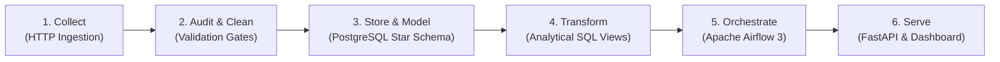
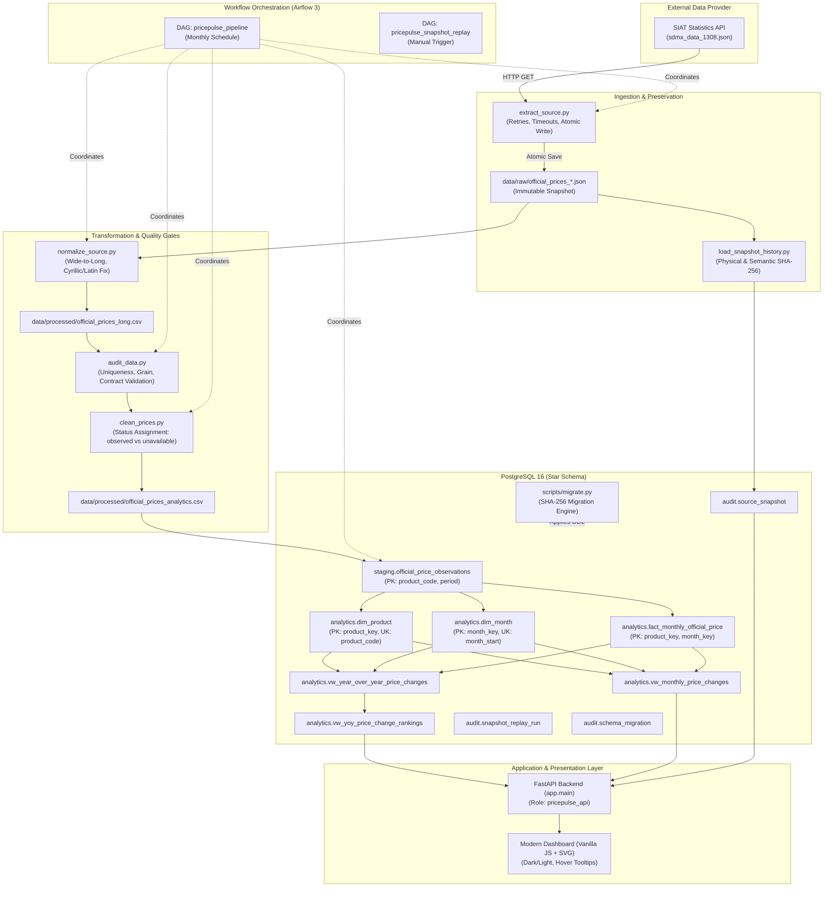
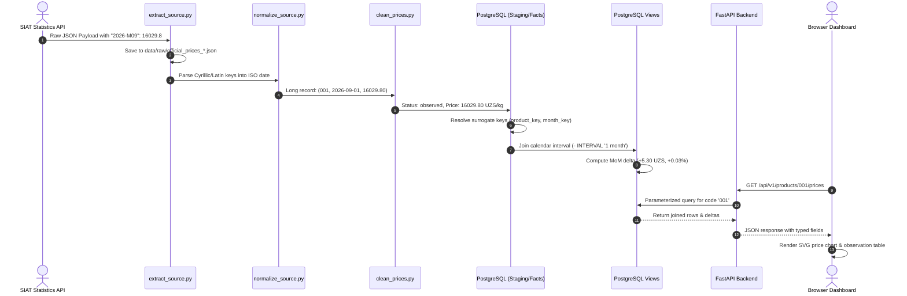

# PricePulse — System Architecture & Engineering Walkthrough

> **Companion Document:** [docs/LEARNING_HANDBOOK.md](LEARNING_HANDBOOK.md)
> This guide explains the complete architecture of PricePulse from first principles: what each component does, why it exists, how data flows through the system, and how to trace a real commodity observation from an external JSON payload all the way to a browser chart.

---

## Table of Contents

1. [Product Purpose & Real-World Context](#1-product-purpose--real-world-context)
2. [The Complete Data Lifecycle](#2-the-complete-data-lifecycle)
3. [End-to-End System Architecture Diagram](#3-end-to-end-system-architecture-diagram)
4. [Component Deep Dive & Reference Table](#4-component-deep-dive--reference-table)
5. [Technical Concepts Behind the Implementation](#5-technical-concepts-behind-the-implementation)
6. [Complete Worked Example: Tracing Rice (Code 001)](#6-complete-worked-example-tracing-rice-code-001)
7. [Tracing an Unavailable Observation: Watermelon (Code 0050)](#7-tracing-an-unavailable-observation-watermelon-code-0050)
8. [Separation of Concerns: Why Logic Isn't Duplicated](#8-separation-of-concerns-why-logic-isnt-duplicated)

---

## 1. Product Purpose & Real-World Context

### The Real-World Domain
PricePulse is built around official monthly average consumer prices published by the **State Committee of the Republic of Uzbekistan on Statistics (SIAT)**.

In economic data analysis, commodity prices (rice, beef, flour, onions, cooking oil) are essential leading indicators of consumer inflation, cost-of-living shifts, and regional market liquidity. However, public statistical agencies typically publish data for human visual consumption or basic archival download, not for high-frequency analytical systems.

### The Upstream Data Challenges
1. **Unfriendly Structure:** Data is published in a wide, tabular JSON layout where each month is an arbitrary dictionary key (e.g., `"2021-M01": 13500.0`). Adding a month changes the payload schema.
2. **Encoding Inconsistencies:** Some month keys use the Cyrillic letter `М` (`\u041c`) while others use the Latin letter `M` (`\u004d`). Naive string lookups fail silently.
3. **Leading Zero Codes:** Products have official national codes such as `001`, `0004`, `0050`, and `0070`. Storing these as integers destroys the codes (`001` becomes `1`), breaking joins with upstream catalogs.
4. **Seasonal Zeros:** Seasonal summer fruits (like watermelon and melon) have a recorded price of `0.00` during early spring months before the harvest. Treating `0.00` as "free food" distorts inflation calculations; treating it as missing without an audit trail loses source fidelity.
5. **Lack of Ingestion Lineage:** The upstream API can modify or republish historical values at any time. Without immutable raw snapshots and cryptographic hashing, audits are impossible.

### What PricePulse Delivers
PricePulse transforms this raw, volatile source into a **resilient, queryable, and auditable analytical platform**. It allows economists, developers, and analysts to explore trends, track year-over-year commodity movers, and run reproducible audits.

---

## 2. The Complete Data Lifecycle

PricePulse implements the complete modern data lifecycle:



| Lifecycle Phase | Component | Key Responsibility |
|---|---|---|
| **1. Collection** | `scripts/extract_source.py` | Fetches HTTP payloads with exponential-backoff retries, explicit timeouts, and writes timestamped snapshots atomically. |
| **2. Audit & Cleaning** | `scripts/audit_data.py`<br/>`scripts/clean_prices.py` | Validates schema contracts and primary key uniqueness; maps `0.00` to analytical `NULL` while preserving source records. |
| **3. Storage & Modeling**| `scripts/load_to_postgres.py` | Loads raw observations into staging, then populates a dimensional star schema within a single ACID transaction. |
| **4. Transformation** | `sql/011_create_analytics_views.sql`<br/>`sql/012_price_change_rankings.sql` | Computes calendar-aligned MoM and YoY price percentage changes and ranks market movers directly inside PostgreSQL. |
| **5. Orchestration** | `airflow/dags/pricepulse_pipeline.py` | Manages scheduled monthly runs, retries failed tasks, and monitors system health in Airflow 3. |
| **6. Serving** | `app/main.py`<br/>`app/static/` | Serves REST endpoints to client applications and renders an interactive web dashboard for human analysis. |

---

## 3. End-to-End System Architecture Diagram



---

## 4. Component Deep Dive & Reference Table

Every file in PricePulse has a single, well-defined responsibility.

| Component / Path | Primary Purpose | Inputs | Outputs | Dependencies | Failure Mode & Recovery |
|---|---|---|---|---|---|
| **`scripts/extract_source.py`** | Downloads raw source payload | Upstream SIAT API URL | `data/raw/official_prices_<timestamp>.json` | `urllib.request` | Retries 3 times with exponential backoff; if source is down, exits with code 1 without corrupting local files. |
| **`scripts/load_snapshot_history.py`** | Registers raw snapshot with cryptographic hashes | Raw snapshot file path | Row in `audit.source_snapshot` | PostgreSQL (`audit.source_snapshot`) | If already registered, verifies SHA-256 match; fails if identical filename has modified contents (tamper detection). |
| **`scripts/normalize_source.py`** | Melts wide JSON into long-format tabular data | Raw snapshot JSON | `data/processed/official_prices_long.csv` | `json`, `csv` | Handles Cyrillic `М` vs. Latin `M`; raises `ValueError` if expected metadata or product keys are missing. |
| **`scripts/audit_data.py`** | Enforces data quality gates | Long CSV | Audit log / exit code | `pandas` | Exits with code 1 if duplicates on `(product_code, period)` exist, or if codes have invalid characters. |
| **`scripts/clean_prices.py`** | Applies analytical pricing rules | Long CSV | `data/processed/official_prices_analytics.csv` | `pandas` | Assigns `observed`, `zero_marked_unavailable`, or `missing_in_source`; guarantees non-invented prices. |
| **`scripts/load_to_postgres.py`** | Loads data into staging & star schema | Clean CSV | Rows in `staging.*` and `analytics.*` | `psycopg` (v3) | Wraps entire load in an ACID transaction (`BEGIN ... COMMIT`); any constraint violation triggers complete `ROLLBACK`. |
| **`scripts/migrate.py`** | Discovers and applies schema migrations | `sql/*.sql` files | Schema objects in PostgreSQL | `audit.schema_migration` | Computes SHA-256 of each migration file; skips already-applied files; re-applies views idempotently. |
| **`scripts/replay_snapshot.py`** | Replays historical snapshot in isolation | Snapshot filename | Isolated CSVs & `audit.snapshot_replay_run` | Clean environment | Replays into `data/processed/replays/<snapshot>/<uuid>/`; NEVER alters live production tables. |
| **`scripts/run_pipeline.py`** | Sequential standalone runner for local execution | CLI invocation | Full pipeline execution | All above scripts | Runs pipeline steps sequentially without needing Airflow; halts immediately on any step failure. |
| **`sql/001_create_schema.sql`** | Defines staging schema and observation table | DDL | `staging.official_price_observations` | PostgreSQL | Enforces non-negative prices, month-start dates, and valid status codes. |
| **`sql/005_create_analytics_model.sql`**| Defines dimensional star schema | DDL | `dim_product`, `dim_month`, `fact_monthly_official_price` | PostgreSQL | Enforces surrogate foreign keys and fact-table price consistency check constraint. |
| **`sql/011_create_analytics_views.sql`**| Computes MoM and YoY price changes | Views DDL | `vw_monthly_price_changes`, `vw_year_over_year_price_changes` | `analytics.*` | Uses calendar intervals (`- INTERVAL '1 month'`) to guarantee accurate comparisons across timeline gaps. |
| **`sql/012_price_change_rankings.sql`** | Computes deterministic YoY price ranks | View DDL | `vw_yoy_price_change_rankings` | `vw_year_over_year_price_changes`| Uses `RANK() OVER (PARTITION BY ... ORDER BY percent DESC, code)` for deterministic tie-breaking. |
| **`airflow/dags/pricepulse_pipeline.py`**| Schedules and coordinates monthly ingestion | Schedule (`@monthly`) | Orchestrated workflow execution | Airflow 3 runtime | Retries failed tasks automatically; provides visibility and alerts in Airflow UI. |
| **`airflow/dags/pricepulse_snapshot_replay.py`**| Orchestrates snapshot replay via Airflow UI | Snapshot param | Orchestrated replay run | Airflow 3 runtime | Exposes a parameter form in Airflow for operators to replay any registered snapshot on demand. |
| **`app/main.py`** | FastAPI application entry point | HTTP requests | JSON API responses & HTML UI | `fastapi`, `uvicorn` | Implements `/health/ready` check, dependency injection for DB connections, and CORS handling. |
| **`app/queries.py`** | Reusable parameterized SQL queries | Query parameters | Psycopg cursor results | `analytics.*` views | Uses parameterized SQL (`%(code)s`) to eliminate SQL injection vulnerabilities. |
| **`app/schemas.py`** | Pydantic v2 data transfer contracts | Raw DB dicts | Validated, typed JSON models | `pydantic` | Validates outgoing API shapes and serializes dates and decimals cleanly. |
| **`app/static/app.js`** | Interactive dashboard client | API responses | Dynamic DOM & SVG charts | Vanilla JS | Implements dark/light mode, SVG rendering, hover crosshairs, floating tooltips, and honest gap handling. |
| **`compose.yaml`** | Container orchestration specification | Environment vars | 4 interconnected services | Docker Compose v2 | Configures service dependency chains (`condition: service_healthy`) and volume persistence. |

---

## 5. Technical Concepts Behind the Implementation

### 1. Python Application Architecture
- **Atomic File Writes:** When writing files, writing directly to `output.json` risks corrupting data if the process crashes midway. PricePulse writes to `output.json.tmp` and executes `os.replace("output.json.tmp", "output.json")`. On POSIX filesystems, `os.replace` is an **atomic operating system syscall**—either the complete file replaces the old one, or nothing changes.
- **Separation of Extraction and Inspection:** Earlier versions combined downloading and terminal printing into one script. PricePulse strictly decouples them: `extract_source.py` performs resilient I/O, while `inspect_source.py` reads existing snapshots for debugging.

### 2. Relational Database Design (PostgreSQL)
- **OLTP vs. OLAP:** An Online Transaction Processing (OLTP) database prioritizes high-speed writes and normalized 3NF structures to eliminate redundancy. An Online Analytical Processing (OLAP) database prioritizes read performance, aggregation speed, and simplicity for analytical queries. PricePulse models its analytical layer as a **Kimball Star Schema**.
- **Surrogate Keys vs. Natural Keys:**
  - `product_code` is a natural business key (e.g., `'001'`).
  - `product_key` is a surrogate key (a monotonically increasing 64-bit integer: `BIGINT GENERATED ALWAYS AS IDENTITY`).
  *Why use surrogate keys?* Natural keys can change upstream (e.g., if the government re-codes commodities). A surrogate key shields foreign keys in fact tables from external upstream churn.
- **The Fact Table Grain:** The grain of `analytics.fact_monthly_official_price` is **exactly one commodity observation per calendar month**. This is enforced by the composite primary key:
  ```sql
  PRIMARY KEY (product_key, month_key)
  ```
- **Strings for Codes:** Product codes like `'001'` or `'0050'` must remain strings. Converting `'001'` to integer `1` permanently destroys leading zeros, breaking foreign joins and upstream audits.
- **Database Roles & Least Privilege:** The web API connects as `pricepulse_api`, which is granted `SELECT` strictly on `analytics.*` and `audit.source_snapshot`. All DDL and write permissions are revoked. Even if an attacker exploited a vulnerability in the web server, they cannot drop tables or alter financial data.

### 3. Data Quality & Cleaning
- **`NULL` vs. Zero:** In commodity economics, `0.00 UZS` does NOT mean "free food." When watermelon is recorded as `0.00` in March, it indicates the commodity was unavailable out-of-season. Coercing this to zero would falsely deflate consumer price indices. Setting it to `NULL` preserves statistical accuracy while the status column (`zero_marked_unavailable`) preserves auditing intent.
- **Database Consistency Constraints:** PostgreSQL check constraints enforce business invariants at the database level:
  ```sql
  CONSTRAINT ck_fact_price_consistency CHECK (
      (price_status = 'observed' AND source_price_uzs_per_kg > 0 AND average_price_uzs_per_kg = source_price_uzs_per_kg)
      OR (price_status = 'zero_marked_unavailable' AND source_price_uzs_per_kg = 0 AND average_price_uzs_per_kg IS NULL)
      OR (price_status = 'missing_in_source' AND source_price_uzs_per_kg IS NULL AND average_price_uzs_per_kg IS NULL)
  )
  ```
  No application bug can ever insert a row that violates this contract.

### 4. Analytical SQL
- **Calendar-Based Joins vs. Positional LAG:**
  *Naive approach:*
  ```sql
  LAG(average_price_uzs_per_kg, 1) OVER (PARTITION BY product_key ORDER BY month_key)
  ```
  *The Failure Case:* If data for February is missing, `LAG(1)` for March will compare March against January! That is a 2-month change disguised as a 1-month change.
  *PricePulse approach:*
  ```sql
  LEFT JOIN analytics.dim_month AS previous_month
      ON previous_month.month_start = (current_month.month_start - INTERVAL '1 month')::DATE
  LEFT JOIN analytics.fact_monthly_official_price AS previous_fact
      ON previous_fact.product_key = current_fact.product_key
     AND previous_fact.month_key = previous_month.month_key
  ```
  If February is missing, `previous_fact` is `NULL`, and the MoM change correctly outputs `NULL`.
- **Deterministic Ranking:** In `analytics.vw_yoy_price_change_rankings`, price changes are ranked using:
  ```sql
  RANK() OVER (PARTITION BY month_start ORDER BY yoy_change_percent DESC, product_code ASC)
  ```
  Adding `product_code ASC` ensures that if two commodities have the identical percentage change (+15.00%), their relative ranking is completely deterministic across repeated queries.

### 5. Snapshot Reproducibility & Auditing
- **Physical vs. Semantic Hashing:**
  - *Physical SHA-256:* Computes the hash of the raw bytes of the downloaded JSON file. If two files have different whitespace or dictionary key ordering, their physical hashes differ.
  - *Semantic SHA-256 (v2):* Canonicalizes the dataset by sorting products by `product_code`, sorting period keys chronologically, and hashing the canonical payload. If the government publishes the exact same numbers in a different key order, PricePulse detects that the semantic content is identical.
- **Isolated Snapshot Replay:** The replay engine in `scripts/replay_snapshot.py` allows operators to test how an older snapshot would be processed under current cleaning rules without touching the live database.

---

## 6. Complete Worked Example: Tracing Rice (Code 001)

Let's follow one real monthly observation for **Rice (Product Code `001`)** for **September 2026** through every layer of the platform.



### Stage 1: The Raw Source JSON
The upstream API returns an array containing product objects. Rice is represented with code `"001"`:
```json
{
  "code": "001",
  "name_uz": "Guruch",
  "name_ru": "Рис",
  "name_en": "Rice",
  "name_uz_cyrillic": "Гуруч",
  "2026-M08": 16024.5,
  "2026-M09": 16029.8
}
```

### Stage 2: HTTP Extraction
`scripts/extract_source.py` fetches the payload via HTTP GET with a 30-second timeout. It validates the schema and writes atomically to `data/raw/official_prices_20261026T042335Z.json`.

### Stage 3: Normalization (Wide to Long)
`scripts/normalize_source.py` reads the JSON. It normalizes `"2026-M09"` to the ISO first-of-month date `2026-09-01` and writes `data/processed/official_prices_long.csv`:
```csv
product_code,product_name_uz,product_name_ru,product_name_en,product_name_uz_cyrillic,period,average_price_uzs_per_kg,source_fetched_at_utc,source_snapshot
001,Guruch,Рис,Rice,Гуруч,2026-09-01,16029.8,2026-10-26T04:23:35Z,official_prices_20261026T042335Z.json
```

### Stage 4: Data Quality Audit
`scripts/audit_data.py` inspects the DataFrame:
- Primary key `(001, 2026-09-01)` is unique (no duplicates).
- `product_code` matches `^[0-9A-Za-z_-]+$`.
- Period matches `^\d{4}-\d{2}-01$`.
- Price is non-negative ($16,029.80 \ge 0$).
Audit passes with exit code `0`.

### Stage 5: Analytical Cleaning
`scripts/clean_prices.py` evaluates the price:
- `source_price` = `16029.80` ($> 0$).
- `average_price_uzs_per_kg` = `16029.80`.
- `price_status` = `'observed'`.
Writes to `data/processed/official_prices_analytics.csv`.

### Stage 6: PostgreSQL Staging
`scripts/load_to_postgres.py` inserts the record into `staging.official_price_observations` using an upsert:
```sql
INSERT INTO staging.official_price_observations (...)
VALUES ('001', 'Rice', ..., '2026-09-01', 16029.80, 16029.80, 'observed', ...)
ON CONFLICT (product_code, period) DO UPDATE ...;
```

The CSV is a normalized representation of one complete source snapshot, not a partial batch. Before writing, the loader checks that its product-by-month grid matches the registered snapshot and refuses to load an older snapshot. After upserting the incoming rows, it removes staging observations and fact rows omitted by the snapshot, then removes orphaned product/month dimensions. These changes and the fact upsert commit atomically; a failed check or write leaves the previous live dataset intact. Raw snapshots and replay records remain available for historical audits, but the live fact table contains only the latest accepted values.

### Stage 7: Resolving Dimension Keys
Within the same transaction, the loader ensures dimensions are populated:
- `analytics.dim_product` has `product_code = '001'` $\rightarrow$ assigned surrogate `product_key = 1`.
- `analytics.dim_month` has `month_start = '2026-09-01'` $\rightarrow$ assigned surrogate `month_key = 202609`.

### Stage 8: Loading the Fact Table
The loader writes the fact row:
```sql
INSERT INTO analytics.fact_monthly_official_price (
    product_key, month_key, source_price_uzs_per_kg,
    average_price_uzs_per_kg, price_status, source_fetched_at_utc, source_snapshot
) VALUES (
    1, 202609, 16029.80, 16029.80, 'observed',
    '2026-10-26 04:23:35+00', 'official_prices_20261026T042335Z.json'
) ON CONFLICT (product_key, month_key) DO UPDATE ...;
```

### Stage 9: Calculating Analytical Trends
When `analytics.vw_monthly_price_changes` is queried:
1. It selects the current row (`month_start = 2026-09-01`, price = `16029.80`).
2. It looks for `previous_month` where `month_start = 2026-09-01 - INTERVAL '1 month'` (`2026-08-01`).
3. It finds the August fact row for Rice (`average_price = 16024.50`).
4. It computes:
   $$\text{Delta} = 16,029.80 - 16,024.50 = +5.30\text{ UZS}$$
   $$\text{Percentage Change} = \text{ROUND}\left(100.0 \times \frac{5.30}{16,024.50}, 2\right) = +0.03\%$$

### Stage 10: API Retrieval
The user queries the REST API:
```bash
curl -s http://127.0.0.1:8000/api/v1/products/001/prices?limit=2
```
FastAPI executes `queries.PRODUCT_PRICES_SQL` via psycopg and returns:
```json
{
  "product_code": "001",
  "product_name_en": "Rice",
  "total": 69,
  "items": [
    {
      "period": "2026-09-01",
      "current_price_uzs_per_kg": 16029.8,
      "current_price_status": "observed",
      "previous_period": "2026-08-01",
      "previous_price_uzs_per_kg": 16024.5,
      "change_uzs_per_kg": 5.3,
      "change_percent": 0.03
    }
  ]
}
```

### Stage 11: Dashboard Rendering
`app/static/app.js` fetches the JSON payload:
- Formats the monetary price using locale rules: `16,029.8 UZS`.
- Plots a blue data point on the SVG coordinate plane at $(x_{2026-09}, y_{16029.8})$.
- Renders a table row with status pill `● Observed` and change badge `▲ +0.03%`.
- Attaches hover events to show crosshairs and floating glass tooltip.

### Stage 12: Manual Verification Command
You can verify this exact row directly in PostgreSQL using `psql`:
```bash
docker compose exec db psql -U postgres -d pricepulse -P pager=off -c "
SELECT
    p.product_code,
    p.product_name_en,
    v.month_start,
    v.current_price_uzs_per_kg,
    v.previous_price_uzs_per_kg,
    v.change_uzs_per_kg,
    v.change_percent
FROM analytics.vw_monthly_price_changes v
JOIN analytics.dim_product p ON p.product_code = v.product_code
WHERE p.product_code = '001' AND v.month_start = '2026-09-01';
"
```

---

## 7. Tracing an Unavailable Observation: Watermelon (Code 0050)

To see how the platform prevents data corruption, let's trace **Watermelon (Product Code `0050`)** for **March 2025**.

1. **Source JSON:** `"2025-M03": 0.0`
2. **Normalization:** Extracted as `period = 2025-03-01`, `average_price = 0.0`.
3. **Cleaning Rule (`scripts/clean_prices.py`):**
   ```python
   if source_price == 0:
       analytical_price = None  # Explicit Python None -> SQL NULL
       status = "zero_marked_unavailable"
   ```
4. **PostgreSQL Fact Row:**
   - `source_price_uzs_per_kg`: `0.00` (Preserves truth of what the government published).
   - `average_price_uzs_per_kg`: `NULL` (Guarantees mathematical operations ignore it).
   - `price_status`: `'zero_marked_unavailable'`.
5. **Analytical View Calculation:**
   - In `analytics.vw_monthly_price_changes`, `current_fact.average_price_uzs_per_kg` is `NULL`.
   - `change_uzs_per_kg` evaluates to `NULL - previous = NULL`.
   - `change_percent` evaluates to `NULL`.
   - **No fake zero or artificial crash occurs.**
6. **Dashboard Visualization:**
   - The SVG chart recognizes the `NULL` value.
   - It breaks the continuous line path (creating a visible timeline gap).
   - The observations table displays an amber badge: `○ Unavailable`.

---

## 8. Separation of Concerns: Why Logic Isn't Duplicated

A common anti-pattern in beginner systems is duplicating formulas across multiple tiers (e.g., calculating percentage inflation in Python, recalculating it in SQL, and recalculating it again in JavaScript).

PricePulse enforces strict **Separation of Concerns**:

```text
┌────────────────────────────────────────────────────────┐
│ 1. Python Scripts: I/O, Schema Validation & Loader     │
│    - Focus strictly on extraction, types, and loading. │
│    - Does NOT compute market ranks or year-over-year.  │
└──────────────────────────┬─────────────────────────────┘
                           │
┌──────────────────────────▼─────────────────────────────┐
│ 2. PostgreSQL Views: The Single Source of Analytics    │
│    - Computes all MoM deltas, YoY inflation & ranks.   │
│    - Encapsulates calendar math and interval logic.    │
└──────────────────────────┬─────────────────────────────┘
                           │
┌──────────────────────────▼─────────────────────────────┐
│ 3. FastAPI: Thin Delivery & Security Boundary          │
│    - Connects as read-only role 'pricepulse_api'.      │
│    - Validates query parameters and serializes JSON.   │
│    - NEVER duplicates analytical math.                 │
└──────────────────────────┬─────────────────────────────┘
                           │
┌──────────────────────────▼─────────────────────────────┐
│ 4. Dashboard (JS/SVG): Presentation & User Interaction │
│    - Displays pre-calculated figures from the API.     │
│    - Handles DOM events, themes, and SVG rendering.    │
└────────────────────────────────────────────────────────┘
```

**Why this matters:** If the definition of Year-over-Year inflation changes (e.g., adjusting rounding rules), you modify exactly one SQL view (`sql/011_create_analytics_views.sql`). The database, the API, and the dashboard all update automatically without modifying a single line of backend or frontend code.
