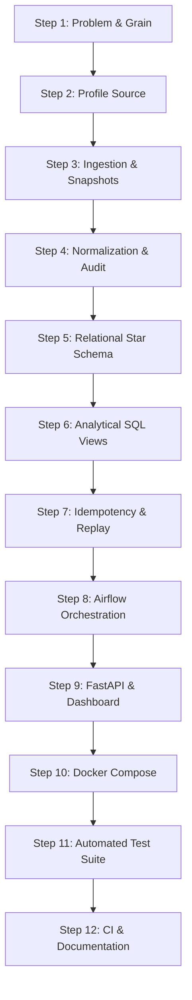

# PricePulse — Building a Data Project from Scratch

> **Companion Document:** [docs/LEARNING_HANDBOOK.md](LEARNING_HANDBOOK.md)
> This guide is a step-by-step engineering blueprint designed to take you from a blank directory to a fully functioning, containerized, test-backed data engineering platform. It teaches the methodology, sequence of decisions, and engineering mindset used to build PricePulse.

---

## Table of Contents

1. [The 12-Step Engineering Roadmap](#1-the-12-step-engineering-roadmap)
   - [Step 1: Define the Problem & Grain](#step-1-define-the-problem--establish-the-grain)
   - [Step 2: Inspect & Profile the Raw Source](#step-2-inspect--profile-the-raw-source)
   - [Step 3: Build the Smallest Working Ingestion Flow](#step-3-build-the-smallest-working-ingestion-flow)
   - [Step 4: Normalize & Enforce Quality Gates](#step-4-normalize--enforce-data-quality-gates)
   - [Step 5: Model & Store (Staging vs. Star Schema)](#step-5-model--store-staging-vs-star-schema)
   - [Step 6: Express Analytical Business Logic in SQL](#step-6-express-analytical-business-logic-in-sql)
   - [Step 7: Guarantee Idempotency & Recovery](#step-7-guarantee-idempotency--recovery)
   - [Step 8: Orchestrate Workflows (Airflow)](#step-8-orchestrate-workflows-with-airflow)
   - [Step 9: Serve via Read-Only API & Dashboard](#step-9-serve-via-read-only-api--dashboard)
   - [Step 10: Containerize for 1-Command Startup](#step-10-containerize-for-1-command-startup)
   - [Step 11: Build Automated Tests & Verification](#step-11-build-automated-tests--verification)
   - [Step 12: Automate CI & Release](#step-12-automate-ci--release)
2. [Scope Discipline: What to Build vs. What to Skip](#2-scope-discipline-what-to-build-vs-what-to-skip)
3. [The Engineering Mindset: Questions Before Code](#3-the-engineering-mindset-questions-before-code)
4. [Mastering AI-Assisted Engineering](#4-mastering-ai-assisted-engineering)

---

## 1. The 12-Step Engineering Roadmap

Many junior developers fail because they build in the wrong order—they start by setting up Docker or designing a frontend before understanding the data. **Senior engineers follow this strict chronological sequence:**



---

### Step 1: Define the Problem & Establish the Grain
- **The Decision to Make:** What specific business question are we answering, who needs the result, and what is the atomic grain of the data?
- **Why Do It First?** If you do not know the grain (the meaning of a single row), you cannot design a database table or write an SQL query.
- **PricePulse Example:**
  - *Business Problem:* Track official monthly inflation and price changes for staple consumer commodities in Uzbekistan.
  - *Target Grain:* **Exactly one commodity observation per calendar month** (e.g., Rice in September 2026).
- **Common Beginner Pitfall:** Starting to write code before establishing whether data is daily, weekly, or monthly, leading to inconsistent aggregations.
- **Verification:** Write down a one-sentence definition of your dataset grain and primary key.
- **What NOT to Build Yet:** Do not configure databases, Docker, or APIs.

---

### Step 2: Inspect & Profile the Raw Source
- **The Decision to Make:** How is the data published? What anomalies, encodings, and missing values exist?
- **Why Do It Here?** Real-world data is messy. You must inspect actual payloads before writing transformation logic.
- **PricePulse Example:**
  - Inspecting `sdmx_data_1308.json` revealed wide columns (`"2021-M01"`), Cyrillic letters (`М`), string codes with leading zeros (`"001"`), and seasonal zeros (`0.0`).
- **Common Beginner Pitfall:** Assuming field names are consistent or assuming numbers are always present and positive.
- **Verification:** Write a short exploratory script (`inspect_source.py`) that prints the JSON structure, key names, and sample values.
- **What NOT to Build Yet:** Do not build automated pipelines or cleaning rules.

---

### Step 3: Build the Smallest Working Ingestion Flow
- **The Decision to Make:** How do we retrieve data reliably and preserve raw history?
- **Why Do It Here?** Preserving an immutable copy of raw data ensures that you can always reprocess or debug if your downstream code has a bug.
- **PricePulse Example:**
  - `scripts/extract_source.py` uses HTTP GET with timeouts, 3 backoff retries, and writes to a temporary file (`.tmp`) before atomic rename.
  - Saves to `data/raw/official_prices_<timestamp>.json`.
- **Common Beginner Pitfall:** Overwriting `latest.json` on every run, destroying all historical auditability.
- **Verification:** Disconnect Wi-Fi during download; verify the script fails gracefully without leaving a corrupt partial file.
- **What NOT to Build Yet:** Do not load into a database.

---

### Step 4: Normalize & Enforce Data Quality Gates
- **The Decision to Make:** How do we convert raw data into a clean, queryable format, and what rules make a record invalid?
- **Why Do It Here?** Analytical queries require long-format data (one observation per row). Invalid records must be stopped before touching the database.
- **PricePulse Example:**
  - `scripts/normalize_source.py` melts wide JSON keys into ISO dates (`2026-09-01`).
  - `scripts/audit_data.py` validates primary key uniqueness on `(product_code, period)`.
  - `scripts/clean_prices.py` maps `0.00` to `NULL` with status `'zero_marked_unavailable'`.
- **Common Beginner Pitfall:** Silently dropping rows that fail validation, hiding data loss from operators.
- **Verification:** Feed an intentionally duplicate or corrupt record into `audit_data.py`; verify it exits with code 1.
- **What NOT to Build Yet:** Do not create database schemas.

---

### Step 5: Model & Store (Staging vs. Star Schema)
- **The Decision to Make:** How should data be structured in the relational database?
- **Why Do It Here?** A flat table works for CSVs, but analytical queries need dimension-fact separation (Kimball Star Schema) to maintain data integrity and query efficiency.
- **PricePulse Example:**
  - `staging.official_price_observations` receives flat CSV data.
  - Dimensions `analytics.dim_product` and `analytics.dim_month` store entity attributes.
  - Fact `analytics.fact_monthly_official_price` stores foreign keys and numerical measures.
- **Common Beginner Pitfall:** Storing product codes as integers, destroying leading zeros (`001` becomes `1`).
- **Verification:** Query `fact_monthly_official_price` joined to dimensions; verify row counts match the source observation count (2,829 rows).
- **What NOT to Build Yet:** Do not write backend APIs or web dashboards.

---

### Step 6: Express Analytical Business Logic in SQL
- **The Decision to Make:** Where should calculations live, and how are time-series metrics computed?
- **Why Do It Here?** Calculating trends in SQL views centralizes business logic. The API and frontend become simple presentation layers.
- **PricePulse Example:**
  - `analytics.vw_monthly_price_changes` computes MoM deltas using calendar intervals (`- INTERVAL '1 month'`).
  - `analytics.vw_yoy_price_change_rankings` computes YoY changes and ranks movers deterministically.
- **Common Beginner Pitfall:** Using positional `LAG()` that silently compares non-adjacent months when a month is missing.
- **Verification:** Run queries directly in `psql` to verify calculations against manual math.
- **What NOT to Build Yet:** Do not write web endpoints.

---

### Step 7: Guarantee Idempotency & Recovery
- **The Decision to Make:** What happens if the pipeline runs twice or crashes midway?
- **Why Do It Here?** Production data pipelines will fail. Idempotency guarantees that re-running a job produces the exact same result without duplicate rows.
- **PricePulse Example:**
  - `scripts/load_to_postgres.py` uses `ON CONFLICT (product_key, month_key) DO UPDATE` wrapped in a single database transaction.
  - `scripts/replay_snapshot.py` runs historical replays into isolated sandbox folders.
- **Common Beginner Pitfall:** Using simple `INSERT` statements that fail or duplicate data on the second run.
- **Verification:** Run `load_to_postgres.py` twice consecutively; verify row count remains exactly 2,829.
- **What NOT to Build Yet:** Do not set up Airflow yet. First verify standalone script execution.

---

### Step 8: Orchestrate Workflows with Airflow
- **The Decision to Make:** How are jobs scheduled, retried, and monitored?
- **Why Do It Here?** Orchestration should be added only AFTER the underlying Python scripts work reliably on their own.
- **PricePulse Example:**
  - `airflow/dags/pricepulse_pipeline.py` schedules ingestion monthly.
  - Uses `BashOperator` to execute existing Python scripts.
- **Common Beginner Pitfall:** Putting heavy data processing logic (pandas transformations) directly inside DAG definition files.
- **Verification:** Trigger the DAG in Airflow UI; verify all tasks transition from green (`success`) in sequence.
- **What NOT to Build Yet:** Do not add complex distributed executors (Celery, Kubernetes) for a small workflow.

---

### Step 9: Serve via Read-Only API & Dashboard
- **The Decision to Make:** How will users and client applications consume the analytical results?
- **Why Do It Here?** Now that modeled data and analytical views exist, building an API is simple: it merely passes query parameters to pre-existing views.
- **PricePulse Example:**
  - FastAPI backend connecting as least-privilege role `pricepulse_api`.
  - Vanilla JS dashboard with interactive SVG charts and honest gap rendering.
- **Common Beginner Pitfall:** Re-calculating inflation percentages in Python or JavaScript instead of querying the SQL view.
- **Verification:** Execute `curl http://localhost:8000/api/v1/analytics/latest-movers`; verify JSON matches SQL output.

---

### Step 10: Containerize for 1-Command Startup
- **The Decision to Make:** How can any developer clone the repository and run it immediately?
- **Why Do It Here?** Containerizing an already-working, tested system is straightforward. Containerizing incomplete, buggy code is painful.
- **PricePulse Example:**
  - `compose.yaml` coordinates `db`, `migrate`, `api`, and `airflow`.
  - Configures port forwarding (`5434:5432`) and volume persistence (`pricepulse_db_data`).
- **Common Beginner Pitfall:** Hardcoding passwords in Dockerfiles or confusing host ports with container ports.
- **Verification:** Run `docker compose down && docker compose up -d --build`; verify all services become healthy.

---

### Step 11: Build Automated Tests & Verification
- **The Decision to Make:** How do we prove the system works and prevent future regressions?
- **Why Do It Here?** Comprehensive testing locks in your architectural invariants.
- **PricePulse Example:**
  - 52 host tests (`test_clean_prices.py`, `test_replay_snapshot.py`, `test_api.py`).
  - 12 container DAG validation tests (`test_dags.py`).
- **Common Beginner Pitfall:** Testing only "happy paths" while ignoring edge cases (null prices, 0.00 prices, invalid codes).
- **Verification:** Run `pytest -v`; confirm 100% pass rate.

---

### Step 12: Automate CI & Release
- **The Decision to Make:** How do we ensure every code commit is automatically verified?
- **PricePulse Example:**
  - `.github/workflows/ci.yml` spins up PostgreSQL 16, runs migrations, and tests the full suite on every push.
  - Thorough documentation (`README.md`, `docs/`).
- **Common Beginner Pitfall:** Treating documentation as an afterthought instead of a core engineering deliverable.
- **Verification:** Inspect GitHub Actions; verify all jobs complete with `success`.

---

## 2. Scope Discipline: What to Build vs. What to Skip

A major mark of seniority is knowing **what NOT to build**. Beginners often add complex technologies to pad their resumes, resulting in fragile, over-engineered architectures.

```text
┌────────────────────────────────────────────────────────────────────────┐
│ The Technology Justification Matrix                                    │
├───────────────────────┬──────────────────────┬─────────────────────────┤
│ Technology            │ When You NEED It     │ Why PricePulse SKIPPED  │
├───────────────────────┼──────────────────────┼─────────────────────────┤
│ Apache Kafka          │ Millions of events/s │ Price data updates once │
│                       │ from hundreds of     │ a month. HTTP batch     │
│                       │ distributed sources. │ extraction is superior. │
├───────────────────────┼──────────────────────┼─────────────────────────┤
│ Apache Spark          │ Terabytes of data    │ 2,829 records easily    │
│                       │ that exceed single-  │ fit in memory. Pandas & │
│                       │ node RAM.            │ PostgreSQL are 100x     │
│                       │                      │ faster to develop.      │
├───────────────────────┼──────────────────────┼─────────────────────────┤
│ Kubernetes (K8s)      │ Dynamic autoscaling  │ A small Docker Compose  │
│                       │ across hundreds of   │ stack boots in seconds  │
│                       │ nodes & microservices│ and runs anywhere.      │
├───────────────────────┼──────────────────────┼─────────────────────────┤
│ dbt (data build tool) │ Hundreds of complex  │ 8 clean SQL migrations  │
│                       │ inter-dependent SQL  │ run via Python provide  │
│                       │ transformations.     │ zero-dependency clarity.│
└───────────────────────┴──────────────────────┴─────────────────────────┘
```

> [!TIP]
> **Engineering Rule of Thumb:** Always choose the simplest technology that completely solves the problem. You can always introduce Spark or Kafka later when data volume justifies it.

---

## 3. The Engineering Mindset: Questions Before Code

Whenever you start a new engineering task, run through this mental checklist:

1. **Requirements First:** What is the exact input, what is the exact output, and what are the constraints?
2. **Grain Definition:** What constitutes one record? Can two records share the same primary key?
3. **Failure Isolation:** If this specific step fails, does it corrupt the database or cleanly stop?
4. **Idempotent Execution:** Can I safely run this command 10 times in a row?
5. **Separation of Logic:** Am I mixing business calculations into an ingestion script or web handler?
6. **Reversibility:** If I deploy this migration or change, can I roll it back without data loss?
7. **Observable Telemetry:** If this fails at 3:00 AM, will the log message tell me exactly what broke?

---

## 4. Mastering AI-Assisted Engineering

Working with AI coding agents (like Google Antigravity or Cursor) requires active intellectual engagement.

### The 4 Levels of AI-Assisted Engineers

```text
Level 1: The Blind Copy-Paster
         Prompts: "Write a data pipeline for me."
         Outcome: Incoherent spaghetti code, breaks immediately, engineer cannot explain it.

Level 2: The Command Runner
         Prompts: "Fix this error." Runs whatever the agent suggests without reading.
         Outcome: Solves immediate syntax errors, but creates deeper architectural debt.

Level 3: The Architecture Reviewer
         Prompts: Asks for options, reviews schemas, inspects diffs, and guides the design.
         Outcome: Coherent system, engineer understands 80% of choices.

Level 4: The Senior Partner (YOUR GOAL)
         Prompts: Defines constraints, establishes data contracts, directs modularization,
                  and verifies every invariant with automated tests.
         Outcome: Production-grade platform; engineer owns the architecture completely.
```

### Prompt Templates for Independent Learning

- **Designing a Model:**
  *"I am modeling monthly price data. Propose a Kimball Star Schema with surrogate keys and check constraints in PostgreSQL. Explain why we should not use a flat 3NF schema."*
- **Investigating an Error:**
  *"Explain the root cause of this error: `psycopg.errors.CheckViolation: new row for relation "fact_monthly_official_price" violates check constraint`. Do not write code yet; explain what row values would violate the constraint."*
- **Refactoring:**
  *"Review `scripts/clean_prices.py`. Identify any implicit assumptions or side effects, and suggest how to make this function pure and unit-testable."*
