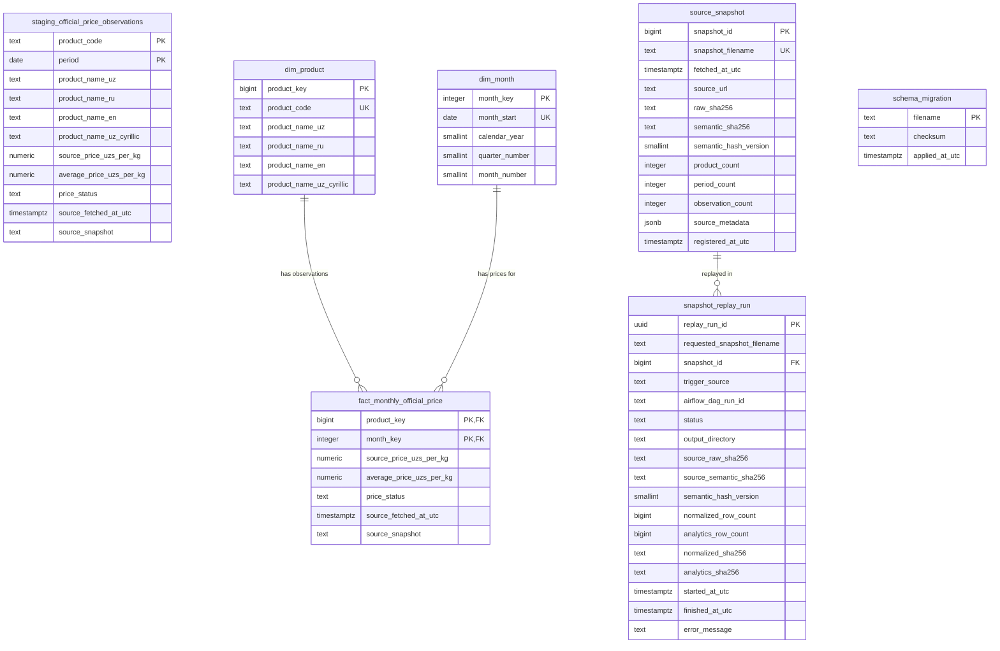

# PricePulse — Data Model & Analytical SQL Guide

> **Companion Document:** [docs/LEARNING_HANDBOOK.md](LEARNING_HANDBOOK.md)
> This guide is an in-depth reference for the PricePulse PostgreSQL relational database. It covers the Star Schema dimensional model, staging layers, audit tables, check constraints, calendar-aligned window views, and practical SQL queries.

---

## Table of Contents

1. [Database Architecture & Design Strategy](#1-database-architecture--design-strategy)
2. [Complete Entity-Relationship (ER) Diagram](#2-complete-entity-relationship-er-diagram)
3. [Table-by-Table Data Dictionary](#3-table-by-table-data-dictionary)
4. [Price Status Semantics & Integrity Rules](#4-price-status-semantics--integrity-rules)
5. [Why Calendar Joins Beat Positional LAG](#5-why-calendar-joins-beat-positional-lag)
6. [Analytical Views & Ranking Semantics](#6-analytical-views--ranking-semantics)
7. [Database Roles & Security Isolation](#7-database-roles--security-isolation)
8. [Practical SQL Queries for Operators & Analysts](#8-practical-sql-queries-for-operators--analysts)

---

## 1. Database Architecture & Design Strategy

PricePulse uses **PostgreSQL 16** structured into three isolated schemas, each serving a distinct architectural role:

```text
┌────────────────────────────────────────────────────────────────────────┐
│ PostgreSQL Database: pricepulse                                        │
├────────────────────────────────────────────────────────────────────────┤
│ 1. staging Schema                                                      │
│    - Transient landing zone for raw normalized CSV extracts.           │
│    - Wide columns, mirrors flat observation files before star modeling.│
│                                                                        │
│ 2. analytics Schema (Kimball Star Schema)                              │
│    - Dimensional tables: dim_product, dim_month.                       │
│    - Central fact table: fact_monthly_official_price.                  │
│    - Materialized / Virtual SQL Views: MoM, YoY, and Rankings.         │
│                                                                        │
│ 3. audit Schema                                                        │
│    - Cryptographic snapshot registration: source_snapshot.             │
│    - Isolated snapshot replay execution history: snapshot_replay_run.  │
│    - Automated DDL migration tracking: schema_migration.               │
└────────────────────────────────────────────────────────────────────────┘
```

---

## 2. Complete Entity-Relationship (ER) Diagram



---

## 3. Table-by-Table Data Dictionary

### Staging Layer

#### `staging.official_price_observations`
- **Purpose:** Direct relational destination for `data/processed/official_prices_analytics.csv`. It validates types and constraints before dimensional modeling.
- **Grain:** Exactly one observation per commodity code per calendar month (`product_code`, `period`).
- **Primary Key:** `(product_code, period)`
- **Key Columns:**
  - `product_code` (`TEXT`): String commodity identifier (e.g., `'001'`).
  - `period` (`DATE`): First day of the month (e.g., `'2026-09-01'`).
  - `source_price_uzs_per_kg` (`NUMERIC(14,2)`): Raw price as published by upstream source.
  - `average_price_uzs_per_kg` (`NUMERIC(14,2)`): Validated analytical price (or `NULL` if unavailable).
  - `price_status` (`TEXT`): Status indicator (`'observed'`, `'zero_marked_unavailable'`, `'missing_in_source'`).
- **Check Constraints:**
  - `ck_period_month_start`: `EXTRACT(DAY FROM period) = 1`
  - `ck_source_price_nonnegative`: `source_price_uzs_per_kg >= 0 OR NULL`
  - `ck_price_status_consistency`: Enforces mutual exclusivity between prices and status codes.

---

### Analytics Star Schema

#### `analytics.dim_product`
- **Purpose:** Dimension table storing official commodity descriptors across 4 language representations.
- **Grain:** Exactly one row per tracked commodity (41 commodities in current baseline).
- **Primary Key:** `product_key` (`BIGINT GENERATED ALWAYS AS IDENTITY`)
- **Natural Unique Key:** `product_code` (`TEXT UNIQUE NOT NULL`)
- **Descriptive Attributes:**
  - `product_name_uz`: Uzbek Latin (e.g., *"Bug'doy"*).
  - `product_name_ru`: Russian (e.g., *"Пшеница"*).
  - `product_name_en`: English (e.g., *"Wheat"*).
  - `product_name_uz_cyrillic`: Uzbek Cyrillic (e.g., *"Буғдой"*).

#### `analytics.dim_month`
- **Purpose:** Date dimension modeling continuous monthly time series. Precomputes calendar calendar year, quarter, and month number for rapid filtering.
- **Grain:** Exactly one row per calendar month (69 months: `2021-01-01` to `2026-09-01`).
- **Primary Key:** `month_key` (`INTEGER`, e.g., `202609`)
- **Natural Unique Key:** `month_start` (`DATE UNIQUE NOT NULL`)
- **Check Constraints:**
  - `ck_month_key`: `month_key = (calendar_year * 100 + month_number)`
  - `ck_month_start`: `EXTRACT(DAY FROM month_start) = 1`
  - `ck_quarter_number`: `quarter_number BETWEEN 1 AND 4`

#### `analytics.fact_monthly_official_price`
- **Purpose:** Central fact table storing monthly price observations with foreign keys linking to dimensions.
- **Grain:** Exactly one observation per commodity per calendar month (2,829 total rows).
- **Composite Primary Key:** `(product_key, month_key)`
- **Foreign Keys:**
  - `product_key` $\rightarrow$ `analytics.dim_product(product_key)`
  - `month_key` $\rightarrow$ `analytics.dim_month(month_key)`
- **Measures & Lineage:**
  - `source_price_uzs_per_kg`: Exact number reported in upstream source.
  - `average_price_uzs_per_kg`: Analytical price used in mathematical aggregations (`NULL` when unobserved).
  - `price_status`: Categorical observation status.
  - `source_fetched_at_utc`: UTC timestamp when snapshot was retrieved.
  - `source_snapshot`: Filename of the immutable raw snapshot JSON.
- **Constraint Contract:**
  ```sql
  CONSTRAINT ck_fact_price_consistency CHECK (
      (price_status = 'observed' AND source_price_uzs_per_kg > 0
       AND average_price_uzs_per_kg IS NOT NULL
       AND average_price_uzs_per_kg = source_price_uzs_per_kg)
      OR (price_status = 'zero_marked_unavailable' AND source_price_uzs_per_kg = 0
          AND average_price_uzs_per_kg IS NULL)
      OR (price_status = 'missing_in_source' AND source_price_uzs_per_kg IS NULL
          AND average_price_uzs_per_kg IS NULL)
  )
  ```

---

### Audit Schema

#### `audit.source_snapshot`
- **Purpose:** Cryptographic registry of every raw JSON file downloaded by the ingestion pipeline.
- **Primary Key:** `snapshot_id` (`BIGINT GENERATED ALWAYS AS IDENTITY`)
- **Unique Key:** `snapshot_filename` (`TEXT UNIQUE`)
- **Integrity Columns:**
  - `raw_sha256`: Hexadecimal SHA-256 hash of the downloaded raw bytes (`^[0-9a-f]{64}$`).
  - `semantic_sha256`: Canonicalized JSON hash invariant to whitespace or key-order changes.
  - `semantic_hash_version`: Hashing algorithm version (`1` for v1, `2` for v2 canonical sort).
  - `observation_count`: Verified count of price observations contained in the snapshot (e.g., `2829`).

#### `audit.snapshot_replay_run`
- **Purpose:** Audit ledger recording every execution of the historical snapshot replay engine.
- **Primary Key:** `replay_run_id` (`UUID`)
- **Foreign Key:** `snapshot_id` $\rightarrow$ `audit.source_snapshot(snapshot_id)`
- **Key Columns:**
  - `trigger_source`: `'cli'` or `'airflow'`.
  - `status`: `'running'`, `'succeeded'`, or `'failed'`.
  - `output_directory`: Isolated sandbox path (`data/processed/replays/<snapshot>/<uuid>/`).
  - `normalized_sha256` / `analytics_sha256`: Cryptographic hashes of the replayed CSV outputs.
  - `error_message`: Captured stack trace if the replay aborted (`NOT NULL` if `status = 'failed'`).

#### `audit.schema_migration`
- **Purpose:** Tracks executed SQL migration scripts to guarantee idempotent database setup.
- **Primary Key:** `filename` (`TEXT`, e.g., `'001_create_schema.sql'`)
- **Columns:**
  - `checksum`: SHA-256 hash of the `.sql` script at execution time.
  - `applied_at_utc`: Timestamp when migration committed.

---

## 4. Price Status Semantics & Integrity Rules

In data engineering, understanding **the semantics of missing data** is what separates robust platforms from fragile scripts.

| Status | Source Price | Analytical Price | Real-World Meaning | How It's Handled |
|---|---|---|---|---|
| `'observed'` | $> 0.00$ | Equal to source | The commodity was actively traded in markets and official surveyors recorded an average price. | Participates in MoM, YoY, and ranking computations. |
| `'zero_marked_unavailable'` | $= 0.00$ | `NULL` | Seasonal commodity (e.g., watermelon in March) was out of season. Upstream recorded `0.00` to indicate absence of trade. | Source `0.00` is preserved for audits. Analytical price is set to `NULL` so math formulas do not calculate 100% price crashes. |
| `'missing_in_source'` | `NULL` | `NULL` | The commodity existed in the catalog, but no survey field was provided for that month. | Analytical price is `NULL`. Excluded from price calculations. |

> [!IMPORTANT]
> **Why `NULL` is not zero:** If watermelon is priced at 12,000 UZS/kg in August and recorded as 0.00 UZS/kg in September, treating zero as an analytical price produces a **-100.00% price drop**. When watermelon reappears at 14,000 UZS/kg the following June, it produces an **infinite percentage gain**. Mapping out-of-season zeros to `NULL` prevents corrupting economic inflation indicators.

---

## 5. Why Calendar Joins Beat Positional LAG

A standard beginner pattern for calculating month-over-month differences is SQL window functions:

```sql
-- DANGEROUS: Positional Lag
SELECT
    product_key,
    month_key,
    average_price_uzs_per_kg,
    LAG(average_price_uzs_per_kg, 1) OVER (
        PARTITION BY product_key ORDER BY month_key
    ) AS previous_price
FROM analytics.fact_monthly_official_price;
```

### The Silent Bug
Consider this timeline for an irregular product where data was not surveyed in February:
- Jan 2026 (`202601`): `10,000 UZS`
- Feb 2026 (`202602`): *(Missing row or unobserved)*
- Mar 2026 (`202603`): `11,000 UZS`

`LAG(1)` for March looks at the preceding **row** in the result set, which is **January**. It calculates:
$$\Delta = 11,000 - 10,000 = +1,000\text{ UZS}$$
This presents a **2-month price change** as if it were a 1-month price change, corrupting downstream reports!

### The PricePulse Solution: Calendar-Aligned Joins
PricePulse explicitly joins on the calendar date:
```sql
FROM analytics.fact_monthly_official_price AS current_fact
JOIN analytics.dim_month AS current_month
    ON current_month.month_key = current_fact.month_key
LEFT JOIN analytics.dim_month AS previous_month
    ON previous_month.month_start = (current_month.month_start - INTERVAL '1 month')::DATE
LEFT JOIN analytics.fact_monthly_official_price AS previous_fact
    ON previous_fact.product_key = current_fact.product_key
   AND previous_fact.month_key = previous_month.month_key
```

If February does not exist in `dim_month` or `fact_monthly_official_price`, `previous_fact` evaluates to `NULL`. The Month-over-Month change for March evaluates cleanly to `NULL`. **Data gaps never turn into false trend lines.**

---

## 6. Analytical Views & Ranking Semantics

All analytical business logic resides in PostgreSQL views in `sql/`:

### 1. `analytics.vw_monthly_price_changes`
- Computes month-over-month price delta (`change_uzs_per_kg`) and percentage change (`change_percent`).
- Uses `NULLIF(previous_fact.average_price_uzs_per_kg, 0)` to guarantee zero-division safety.
- Rounds percentages to 2 decimal places.

### 2. `analytics.vw_year_over_year_price_changes`
- Computes 12-month comparison using:
  ```sql
  comparison_month.month_start = (current_month.month_start - INTERVAL '1 year')::DATE
  ```
- Evaluates `yoy_change_percent` across matching calendar months (e.g., September 2026 vs. September 2025).

### 3. `analytics.vw_yoy_price_change_rankings`
- Ranks commodity inflation within each calendar month:
  - `increase_rank`: Ranked from highest YoY gain down to lowest (`ORDER BY yoy_change_percent DESC, product_code ASC`).
  - `decrease_rank`: Ranked from steepest YoY price drop down to lowest (`ORDER BY yoy_change_percent ASC, product_code ASC`).
- **Deterministic Tie-Breaking:** Adding `product_code ASC` ensures that ties in percentage changes produce identical, reproducible ranking orders.

---

## 7. Database Roles & Security Isolation

PricePulse implements the principle of **least privilege**:

```text
┌───────────────────────┐                    ┌───────────────────────┐
│     pricepulse_dev    │                    │     pricepulse_api    │
├───────────────────────┤                    ├───────────────────────┤
│ Role: Ingestion & ETL │                    │ Role: Web Application │
│ - SELECT              │                    │ - SELECT strictly on: │
│ - INSERT              │                    │   • analytics.*       │
│ - UPDATE              │                    │   • audit.source_snap │
│ - DELETE              │                    │ - ALL write & DDL     │
│ on staging, analytics,│                    │   privileges REVOKED  │
│ and audit schemas.    │                    │ - Zero access to      │
│                       │                    │   staging schema      │
└───────────────────────┘                    └───────────────────────┘
```

The FastAPI web service connects using `pricepulse_api`. Even if an arbitrary SQL execution vulnerability existed in the web layer, an attacker cannot modify or delete data.

---

## 8. Practical SQL Queries for Operators & Analysts

You can execute these queries using `psql` or DBeaver to inspect actual data.

### Query 1: Top 5 YoY Price Increases for the Latest Month
```sql
SELECT
    increase_rank AS rank,
    product_code,
    product_name_en,
    current_price_uzs_per_kg,
    price_12_months_ago_uzs_per_kg,
    yoy_change_percent
FROM analytics.vw_yoy_price_change_rankings
WHERE month_start = (SELECT MAX(month_start) FROM analytics.vw_yoy_price_change_rankings)
  AND increase_rank IS NOT NULL
ORDER BY increase_rank ASC
LIMIT 5;
```

### Query 2: Inspect All Unavailable (Out-of-Season) Price Observations
```sql
SELECT
    p.product_code,
    p.product_name_en,
    m.month_start,
    f.price_status,
    f.source_price_uzs_per_kg,
    f.average_price_uzs_per_kg
FROM analytics.fact_monthly_official_price f
JOIN analytics.dim_product p ON p.product_key = f.product_key
JOIN analytics.dim_month m ON m.month_key = f.month_key
WHERE f.price_status = 'zero_marked_unavailable'
ORDER BY p.product_code, m.month_start;
```

### Query 3: Inspect Snapshot Cryptographic Lineage
```sql
SELECT
    snapshot_filename,
    fetched_at_utc,
    product_count,
    period_count,
    observation_count,
    LEFT(raw_sha256, 12) || '...' AS raw_hash,
    LEFT(semantic_sha256, 12) || '...' AS semantic_hash,
    semantic_hash_version
FROM audit.source_snapshot
ORDER BY fetched_at_utc DESC
LIMIT 5;
```

### Query 4: Check Applied Database Migrations
```sql
SELECT
    filename,
    LEFT(checksum, 12) || '...' AS sha256,
    applied_at_utc
FROM audit.schema_migration
ORDER BY filename;
```
