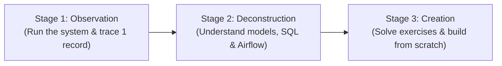
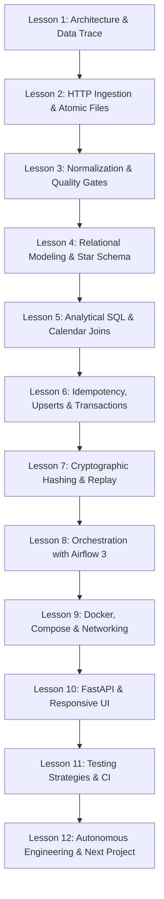
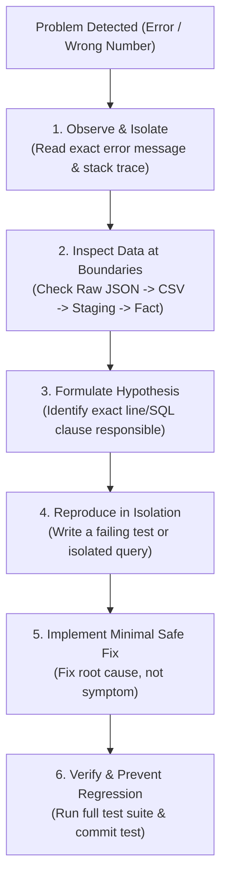

# PricePulse — Personal Engineering Learning Handbook

> **Welcome to PricePulse.**
> This handbook is your personal engineering textbook and mentor guide for the PricePulse data platform. It is designed to take you from understanding basic Python and SQL to mastering the architecture, data modeling, pipeline engineering, container orchestration, and operational habits required of a senior data engineer.

---

## Table of Contents

1. [Orientation & How to Use This Handbook](#1-orientation--how-to-use-this-handbook)
2. [What Did You Build? The High-Level Picture](#2-what-did-you-build-the-high-level-picture)
3. [Documentation Map & Reading Order](#3-documentation-map--reading-order)
4. [The 12-Lesson Learning Curriculum](#4-the-12-lesson-learning-curriculum)
5. [The Engineering Mindset: Questions Before Code](#5-the-engineering-mindset-questions-before-code)
6. [Senior Engineering Diagnostic Checklist](#6-senior-engineering-diagnostic-checklist)
7. [AI-Assisted Engineering: How to Learn with Coding Agents](#7-ai-assisted-engineering-how-to-learn-with-coding-agents)
8. [Current System Status & Verified Inventory](#8-current-system-status--verified-inventory)

---

## 1. Orientation & How to Use This Handbook

If you are reading this, you are the technical owner of PricePulse. You have a fully functional, containerized, test-backed data engineering platform running on your machine.

However, having working code is only half the battle. As an aspiring software and data engineer, your real superpower is **understanding why the code works, what trade-offs were made, how to diagnose failures, and how to build similar systems from scratch**.

### Your Learning Journey

Do not try to read everything in one sitting. Follow this 3-stage approach:



1. **Stage 1: Observation (Day 1–2):** Start the system with Docker Compose, open the browser dashboard, query PostgreSQL with `psql`, and trace one product (Rice `001`) from raw JSON to the UI.
2. **Stage 2: Deconstruction (Week 1):** Follow the 12-Lesson Curriculum below. Read the code files side-by-side with [docs/ARCHITECTURE_WALKTHROUGH.md](ARCHITECTURE_WALKTHROUGH.md) and [docs/DATA_MODEL_AND_SQL_GUIDE.md](DATA_MODEL_AND_SQL_GUIDE.md).
3. **Stage 3: Creation & Extension (Week 2+):** Work through the progressive exercises in [docs/LEARNING_EXERCISES.md](LEARNING_EXERCISES.md) and study [docs/BUILDING_A_DATA_PROJECT_FROM_SCRATCH.md](BUILDING_A_DATA_PROJECT_FROM_SCRATCH.md) to prepare for your next project.

---

## 2. What Did You Build? The High-Level Picture

PricePulse is an **automated commodity price intelligence platform** built around official monthly average prices for essential consumer goods in Uzbekistan.

### The Problem It Solves
Official government price statistics are published as unstructured or semi-structured public API payloads. In their raw state, they cannot be queried efficiently, lack historical audit guarantees, have inconsistent Cyrillic/Latin key encodings, contain seasonal unobserved values (e.g., watermelon in March), and are inaccessible to non-technical analysts.

### What PricePulse Delivers
PricePulse automates the complete lifecycle of this data:
- **Retrieves** raw data safely with timeouts, retries, and atomic snapshot writes.
- **Audits & Cleans** data without inventing missing numbers (distinguishing true zeros from unavailable prices).
- **Stores & Models** data in a clean PostgreSQL Star Schema (`dim_product`, `dim_month`, `fact_monthly_official_price`).
- **Precomputes Trends** using calendar-aligned window views (Month-over-Month and Year-over-Year changes and rankings).
- **Orchestrates Workflows** using Apache Airflow 3 (monthly ingestion and deterministic snapshot replay).
- **Serves** insights through a read-only FastAPI REST backend and a responsive, modern fintech terminal dashboard.

### Why This Is a Data Engineering Portfolio Project
Many beginner projects are merely "a Python script that saves a CSV" or "a notebook with a chart." PricePulse is a true **data engineering platform** because it solves fundamental systems problems:
1. **Idempotency:** You can run the pipeline 100 times, and the database remains clean without duplicates or corrupted state.
2. **Cryptographic Lineage:** Every row in PostgreSQL points back to the exact source snapshot file and its SHA-256 hash.
3. **Audit Reproducibility:** You can replay an ancient historical snapshot in an isolated directory without touching production data.
4. **Least-Privilege Security:** The API service connects as `pricepulse_api` with read-only access to analytics views, with write access explicitly revoked.
5. **Continuous Verification:** 64 automated tests and GitHub Actions CI protect the codebase against regressions.

---

## 3. Documentation Map & Reading Order

The PricePulse documentation is structured into focused, deep-dive guides:

| Document | Primary Focus | When to Read |
|---|---|---|
| **[LEARNING_HANDBOOK.md](LEARNING_HANDBOOK.md)** *(This file)* | Curriculum, engineering principles, learning roadmap, and orientation. | Read first. Return here as your anchor. |
| **[ARCHITECTURE_WALKTHROUGH.md](ARCHITECTURE_WALKTHROUGH.md)** | End-to-end data lifecycle, component breakdown, data & control flows, and worked product trace. | Read during Lessons 1–3. |
| **[DATA_MODEL_AND_SQL_GUIDE.md](DATA_MODEL_AND_SQL_GUIDE.md)** | Star schema design, staging tables, constraints, calendar joins vs row lags, and analytical SQL views. | Read during Lessons 4–6. |
| **[OPERATIONS_RUNBOOK.md](OPERATIONS_RUNBOOK.md)** | Practical CLI operations, startup/shutdown, environment variables, Airflow UI, snapshot replay, and troubleshooting. | Read before running commands and keep open while coding. |
| **[BUILDING_A_DATA_PROJECT_FROM_SCRATCH.md](BUILDING_A_DATA_PROJECT_FROM_SCRATCH.md)** | 12-step blueprint to build your next data project from a blank repository, scope discipline, and design choices. | Read during Lesson 12 and when starting new projects. |
| **[LEARNING_EXERCISES.md](LEARNING_EXERCISES.md)** | Progressive practice exercises (Level 1: Understand, Level 2: Modify, Level 3: Design) with comprehensive solutions. | Solve after completing each lesson. |

---

## 4. The 12-Lesson Learning Curriculum

Follow these 12 lessons sequentially. Each lesson targets a specific component of the real PricePulse codebase.



---

### Lesson 1: Architecture & Data Trace
- **Objective:** Understand how the entire system connects and trace a single record from external JSON to the browser chart.
- **Read:** [docs/ARCHITECTURE_WALKTHROUGH.md](ARCHITECTURE_WALKTHROUGH.md) (Sections 1–4).
- **Inspect:** `scripts/run_pipeline.py`, `app/main.py`.
- **Execute:** Start the stack (`docker compose up -d`), visit `http://localhost:8000/`, and inspect Rice (`001`).
- **Question to Answer:** Why is it bad practice for the browser UI to calculate Month-over-Month price inflation?
- **Hands-on Exercise:** Exercise 1.1 in [docs/LEARNING_EXERCISES.md](LEARNING_EXERCISES.md).
- **Definition of Mastery:** You can draw the system architecture from memory on a whiteboard and explain where every transformation occurs.

---

### Lesson 2: HTTP Ingestion & Safe File Operations
- **Objective:** Master resilient external data extraction, retry logic, timeouts, and atomic file writes.
- **Read:** [docs/ARCHITECTURE_WALKTHROUGH.md](ARCHITECTURE_WALKTHROUGH.md) (Component 1: Ingestion).
- **Inspect:** `scripts/extract_source.py`.
- **Key Concepts:** Exponential backoff, HTTP status validation, temporary files (`.tmp`) and atomic replacement (`os.replace`).
- **Question to Answer:** What happens if a power failure or network cut occurs halfway through downloading a 50MB JSON file? Why does `extract_source.py` prevent file corruption?
- **Hands-on Exercise:** Exercise 1.2 in [docs/LEARNING_EXERCISES.md](LEARNING_EXERCISES.md).
- **Definition of Mastery:** You never write a raw file directly to its destination path; you always use atomic file operations.

---

### Lesson 3: Normalization & Data Quality Auditing
- **Objective:** Learn how to transform wide-format data into clean long-format observations and enforce data quality gates.
- **Read:** [docs/ARCHITECTURE_WALKTHROUGH.md](ARCHITECTURE_WALKTHROUGH.md) (Component 2: Normalization & Audit).
- **Inspect:** `scripts/normalize_source.py`, `scripts/audit_data.py`, `scripts/clean_prices.py`.
- **Key Concepts:** Wide vs. long schema, preserving string codes (`001`), encoding normalization (Cyrillic `М` vs. Latin `M`), fatal errors vs. audit warnings.
- **Question to Answer:** Why should product codes like `001` or `0050` NEVER be stored as integers?
- **Hands-on Exercise:** Exercise 2.1 in [docs/LEARNING_EXERCISES.md](LEARNING_EXERCISES.md).
- **Definition of Mastery:** You can write a pandas validation suite that checks primary key uniqueness, null tolerances, and type contracts before data touches a database.

---

### Lesson 4: Relational Modeling & The Star Schema
- **Objective:** Understand why analytical databases use dimensional models (facts and dimensions) instead of flat tables or 3NF schemas.
- **Read:** [docs/DATA_MODEL_AND_SQL_GUIDE.md](DATA_MODEL_AND_SQL_GUIDE.md) (Sections 1–3).
- **Inspect:** `sql/001_create_schema.sql`, `sql/005_create_analytics_model.sql`.
- **Key Concepts:** Fact tables, Dimension tables, surrogate keys (`product_key`, `month_key`), business keys (`product_code`), check constraints.
- **Question to Answer:** What is the grain of `analytics.fact_monthly_official_price`? What happens if you try to insert two records for the same product and month?
- **Hands-on Exercise:** Exercise 1.3 in [docs/LEARNING_EXERCISES.md](LEARNING_EXERCISES.md).
- **Definition of Mastery:** You can design a Star Schema for any business domain, identifying the facts, dimensions, grains, and constraints.

---

### Lesson 5: Analytical SQL & Calendar-Aligned Joins
- **Objective:** Master advanced SQL window functions, common table expressions (CTEs), and calendar interval joins.
- **Read:** [docs/DATA_MODEL_AND_SQL_GUIDE.md](DATA_MODEL_AND_SQL_GUIDE.md) (Sections 4–6).
- **Inspect:** `sql/011_create_analytics_views.sql`, `sql/012_price_change_rankings.sql`.
- **Key Concepts:** `INTERVAL '1 month'`, `INTERVAL '1 year'`, `RANK() OVER (PARTITION BY ...)`, `NULLIF(..., 0)`.
- **Question to Answer:** If an external source skips reporting prices for February, why does `LAG(price) OVER (ORDER BY month)` produce an incorrect Month-over-Month calculation for March? How does PricePulse prevent this?
- **Hands-on Exercise:** Exercise 2.2 in [docs/LEARNING_EXERCISES.md](LEARNING_EXERCISES.md).
- **Definition of Mastery:** You can write deterministic SQL queries that calculate period-over-period metrics without relying on row-order assumptions.

---

### Lesson 6: Idempotency, Upserts & Database Transactions
- **Objective:** Learn how to make ingestion pipelines idempotent and safe against network or process crashes.
- **Read:** [docs/ARCHITECTURE_WALKTHROUGH.md](ARCHITECTURE_WALKTHROUGH.md) (Section 5: Technical Concepts — SQL & Database).
- **Inspect:** `scripts/load_to_postgres.py`.
- **Key Concepts:** ACID transactions, `BEGIN`, `COMMIT`, `ROLLBACK`, `ON CONFLICT (..) DO UPDATE` (Upsert), staging tables.
- **Question to Answer:** If a pipeline fails after loading 1,000 of 2,829 rows, what state is the database left in? How does a single database transaction protect against partial loads?
- **Hands-on Exercise:** Exercise 2.3 in [docs/LEARNING_EXERCISES.md](LEARNING_EXERCISES.md).
- **Definition of Mastery:** You ensure every data loading script can be run multiple times consecutively without altering the final state or duplicating rows.

---

### Lesson 7: Cryptographic Hashing, Lineage & Replay
- **Objective:** Learn how to track dataset lineage and perform deterministic historical snapshot replays.
- **Read:** [docs/DATA_MODEL_AND_SQL_GUIDE.md](DATA_MODEL_AND_SQL_GUIDE.md) (Audit Layer), `docs/SNAPSHOT_REPLAY.md`.
- **Inspect:** `scripts/load_snapshot_history.py`, `scripts/replay_snapshot.py`, `sql/008_create_snapshot_history.sql`, `sql/010_create_snapshot_replay_runs.sql`.
- **Key Concepts:** Physical SHA-256 vs. Semantic SHA-256 (canonical JSON hashing), isolated directory replay, audit run tables.
- **Question to Answer:** Why might two JSON files have different physical SHA-256 hashes even if their data is 100% identical? How does semantic hashing solve this?
- **Hands-on Exercise:** Exercise 1.4 in [docs/LEARNING_EXERCISES.md](LEARNING_EXERCISES.md).
- **Definition of Mastery:** You can build an audit trail that proves exactly which source file and timestamp produced any given number in a dashboard.

---

### Lesson 8: Orchestration with Apache Airflow 3
- **Objective:** Understand how workflow schedulers coordinate data pipelines, handle retries, and monitor health.
- **Read:** [docs/OPERATIONS_RUNBOOK.md](OPERATIONS_RUNBOOK.md) (Section 4: Airflow Orchestration).
- **Inspect:** `airflow/dags/pricepulse_pipeline.py`, `airflow/dags/pricepulse_snapshot_replay.py`.
- **Key Concepts:** DAGs, Operators, task dependencies (`>>`), Airflow 3 schedule syntax (`schedule="@monthly"`), task retries and idempotency requirements.
- **Question to Answer:** Why shouldn't heavy data transformation logic (like pandas transformations) be written directly inside the Airflow DAG definition file?
- **Hands-on Exercise:** Exercise 2.4 in [docs/LEARNING_EXERCISES.md](LEARNING_EXERCISES.md).
- **Definition of Mastery:** You treat Airflow strictly as an orchestrator and process coordinator, keeping core business logic in standalone, testable Python modules.

---

### Lesson 9: Docker, Compose & Service Networking
- **Objective:** Master containerization, multi-service networking, port forwarding, and data persistence.
- **Read:** [docs/OPERATIONS_RUNBOOK.md](OPERATIONS_RUNBOOK.md) (Section 2: Docker Environment).
- **Inspect:** `compose.yaml`, `Dockerfile`, `airflow/Dockerfile`.
- **Key Concepts:** Host ports vs. container ports (`5434:5432`), bridge networks, persistent named volumes (`pricepulse_db_data`), health checks (`pg_isready`).
- **Question to Answer:** Why does the API container connect to PostgreSQL on port `5432` while your local laptop terminal connects on port `5434`?
- **Hands-on Exercise:** Exercise 1.5 in [docs/LEARNING_EXERCISES.md](LEARNING_EXERCISES.md).
- **Definition of Mastery:** You can configure a multi-container environment with dependency ordering (`depends_on: { condition: service_healthy }`) without port collisions.

---

### Lesson 10: FastAPI & Responsive UI Architecture
- **Objective:** Learn how backend APIs serve modeled data securely to frontend interfaces using least-privilege roles.
- **Read:** [docs/ARCHITECTURE_WALKTHROUGH.md](ARCHITECTURE_WALKTHROUGH.md) (Component 7: API & Dashboard).
- **Inspect:** `app/main.py`, `app/queries.py`, `app/schemas.py`, `app/static/app.js`.
- **Key Concepts:** Parameterized SQL queries, Pydantic response models, least-privilege DB role (`pricepulse_api`), honest chart gap rendering.
- **Question to Answer:** Why is string concatenation in SQL queries (`f"SELECT * FROM ... WHERE code = '{code}'"`) dangerous? How does psycopg parameterized querying protect against SQL injection?
- **Hands-on Exercise:** Exercise 2.5 in [docs/LEARNING_EXERCISES.md](LEARNING_EXERCISES.md).
- **Definition of Mastery:** You can write a typed, documented REST endpoint that delegates all analytical aggregation to database views and validates all user inputs.

---

### Lesson 11: Testing Strategies & CI Automation
- **Objective:** Master the testing pyramid: unit tests, database integration tests, mock tests, and CI workflows.
- **Read:** [docs/OPERATIONS_RUNBOOK.md](OPERATIONS_RUNBOOK.md) (Section 6: Testing & QA).
- **Inspect:** `tests/test_api.py`, `tests/test_clean_prices.py`, `tests/test_dags.py`, `.github/workflows/ci.yml`.
- **Key Concepts:** Pytest fixtures, mock databases, deterministic test fixtures, GitHub Actions workflow runners.
- **Question to Answer:** Why does having 100% passing unit tests with mocks NOT guarantee that your application will work when deployed to production?
- **Hands-on Exercise:** Exercise 2.6 in [docs/LEARNING_EXERCISES.md](LEARNING_EXERCISES.md).
- **Definition of Mastery:** You write tests before shipping features, including automated CI pipelines that spin up real ephemeral databases.

---

### Lesson 12: Autonomous Engineering & Next Project Blueprint
- **Objective:** Synthesize everything you learned and understand how to build a production data product from a blank repo.
- **Read:** [docs/BUILDING_A_DATA_PROJECT_FROM_SCRATCH.md](BUILDING_A_DATA_PROJECT_FROM_SCRATCH.md).
- **Exercise:** Choose a new public dataset (e.g., central bank currency rates, weather observations, or public transit times) and write a 2-page architecture design doc following Step 1 through Step 5 of the blueprint.
- **Definition of Mastery:** You no longer need a step-by-step tutorial. You can evaluate a raw data source, choose the grain, design a Star Schema, build an idempotent pipeline, and ship a tested product.

---

## 5. The Engineering Mindset: Questions Before Code

Senior engineers are not distinguished by how fast they type code, but by **how carefully they think before typing**. Before writing a single line of Python or SQL, a senior engineer asks these 15 questions:

```text
 1. What is the business problem? Who needs this data, and what decision will it inform?
 2. What is the source of truth? Is the upstream source authoritative, immutable, or prone to revisions?
 3. What is the exact grain of the data? What uniquely identifies a single record?
 4. What are the invariants? What must NEVER be true (e.g., negative prices, duplicate keys, null dates)?
 5. How should missing values be handled? Is null distinct from zero? Does missing mean unobserved or free?
 6. How will this pipeline fail? When the network drops or the payload schema changes, what happens?
 7. Is the transformation idempotent? If this job runs twice on the same day, will data duplicate or corrupt?
 8. Where should the computation happen? Does this belong in Python, in PostgreSQL, or in the UI?
 9. What are the security boundaries? Who has write access? Can the web server modify raw data?
10. How will this be tested? Can I verify this logic locally without connecting to live external systems?
11. How will someone debug this at 2:00 AM? Are logs descriptive? Can we trace the raw source snapshot?
12. Is this reproducible? Can another developer clone the repository and run it with one command?
13. What happens during schema evolution? What if the upstream API adds a column or renames a key?
14. Is this abstraction necessary? Am I introducing a complex tool (Kafka, Spark) when PostgreSQL is sufficient?
15. What can be removed? Can this feature be simpler, clearer, and require less maintenance?
```

---

## 6. Senior Engineering Diagnostic Checklist

When something breaks in a data system, junior developers often guess and make random changes. **Senior engineers follow a systematic diagnostic process.** Keep this checklist handy:



### The 6 Diagnostic Rules

1. **Rule of Boundary Inspection:** Data issues always occur at transitions:
   - External API $\rightarrow$ Raw File (`data/raw/`)
   - Raw File $\rightarrow$ Normalized CSV (`data/processed/`)
   - Normalized CSV $\rightarrow$ PostgreSQL Staging (`staging.official_price_observations`)
   - Staging $\rightarrow$ Fact Table (`analytics.fact_monthly_official_price`)
   - Fact Table $\rightarrow$ SQL View $\rightarrow$ API JSON $\rightarrow$ Browser UI
   *Always inspect the data at the boundary immediately preceding the failure.*

2. **Rule of Reproducibility:** If you cannot reproduce a bug with a minimal script or test query, you do not understand the bug yet.

3. **Rule of Root Cause vs. Symptom:** If a frontend chart shows `NaN`, do not simply write `if (isNaN(val)) val = 0;` in JavaScript. Trace back: Why did the API return null? Why did the SQL view produce null? Was the source observation missing? Fix the problem at its true source.

4. **Rule of Least Privilege:** If a service has permission to do something it shouldn't (e.g., the web API dropping a staging table), that is an architectural vulnerability waiting to happen.

5. **Rule of Clean Reversibility:** Every migration, load script, and deploy must have a known, tested rollback path.

6. **Rule of Evidence:** Never say "it works" because a command printed no output. Verify row counts, check database tables, run automated tests, and examine HTTP responses.

---

## 7. AI-Assisted Engineering: How to Learn with Coding Agents

Modern coding agents (Google Antigravity, Cursor, Claude Code) are powerful assistants, but they can be a double-edged sword for learners.

> [!WARNING]
> **The Dependency Trap:** If you ask an agent to "build the project" and you copy/paste the output without understanding every line, you have learned nothing. You will be unable to explain your system in a technical interview and unable to fix it when it breaks in production.

### The 5-Step Collaborative AI Workflow

Use this workflow to maximize your learning and retain architectural agency:

```text
Step 1: Define the Problem Yourself
        Before opening the chat, write down the problem, the inputs, the expected outputs,
        and the constraints in plain English.

Step 2: Ask for Explanations & Trade-offs First
        Prompt: "I need to design a historical replay workflow for my data pipeline.
        Explain 2 different architectural approaches to achieve this in PostgreSQL,
        comparing data isolation, storage cost, and implementation complexity."

Step 3: Review Proposed Architecture Before Code
        Do not let the agent write code until you agree with the design. Ask:
        "Why did you choose an isolated directory over a separate staging database?"

Step 4: Inspect Every Line of the Diff
        When the agent generates code, do not blindly commit it. Read each function:
        - "What does this line do?"
        - "Why is this check constraint necessary?"
        - "What happens if this input is null?"

Step 5: Write the Tests & Reproduce Failures
        Ask the agent to help you design edge-case tests, but run the tests yourself
        in your terminal and inspect the database state directly.
```

### Useful Prompts for Learning

- **For Debugging:**
  *"I am getting `psycopg.errors.IndeterminateDatatype` in `app/queries.py` on line 42. Explain what causes this error in psycopg 3 and why PostgreSQL cannot infer the type of a null query parameter."*
- **For Architectural Critique:**
  *"Inspect `sql/011_create_analytics_views.sql`. Explain why joining on `month_start - INTERVAL '1 month'` is more robust than using `LAG() OVER (PARTITION BY product_key ORDER BY month_key)`."*
- **For Learning SQL:**
  *"Explain the execution plan of `analytics.vw_yoy_price_change_rankings`. Which indexes are utilized, and what would happen to query performance if `analytics.fact_monthly_official_price` had 10 million rows?"*

---

## 8. Current System Status & Verified Inventory

The PricePulse repository has been inspected, executed, tested, and verified against the live Docker runtime:

| Component | Target / Metric | Verified State | Verification Method |
|---|---|---|---|
| **PostgreSQL Database** | Port `5434` (host) / `5432` (internal) | Healthy, PostgreSQL 16 | `docker compose ps` / `psql` |
| **Tracked Products** | 41 official commodities | 41 rows in `analytics.dim_product` | Verified SQL query |
| **Modeled Timeline** | Jan 2021 through Sep 2026 | 69 months in `analytics.dim_month` | Verified SQL query |
| **Total Price Observations** | 2,829 product-month records | 2,829 facts in `analytics.fact_monthly_official_price` | Verified SQL query |
| **Unavailable / Zero Observations**| Seasonal fruits (Watermelon, Melon) | Exactly 6 rows (`zero_marked_unavailable`) | Verified SQL query |
| **Database Migrations** | 8 SQL migrations | 8 applied in `audit.schema_migration` | `scripts/migrate.py` check |
| **API Backend** | Port `8000` | FastAPI (Healthy, docs at `/docs`) | `curl -s http://localhost:8000/health` |
| **Dashboard UI** | Port `8000` (`/`) | Modern dark/light terminal with SVG chart | Headless Chrome screenshot |
| **Airflow Orchestrator** | Port `8080` | Airflow 3.3.2 standalone | `docker compose ps` |
| **Automated Test Suite** | Full platform coverage | 64 tests (52 host + 12 Airflow container) | Automated test execution |
| **GitHub Actions CI** | Clean build & test pipeline | Green (`conclusion: success`) | GitHub Actions API |

---

### Next Step

Open **[docs/ARCHITECTURE_WALKTHROUGH.md](ARCHITECTURE_WALKTHROUGH.md)** to begin Lesson 1 and trace your first record through the platform!
